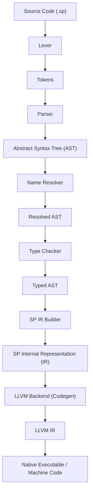
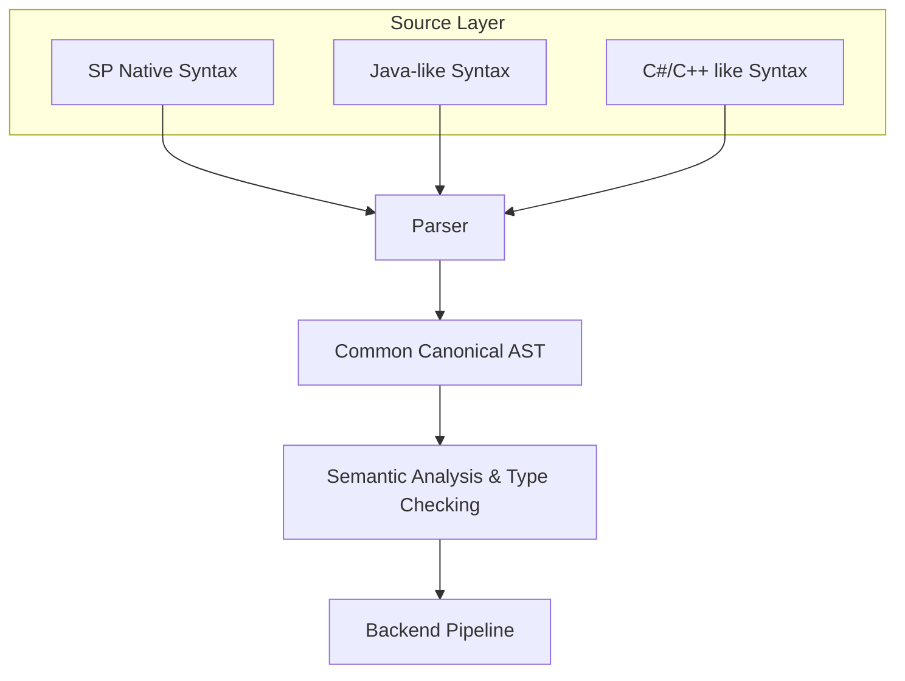
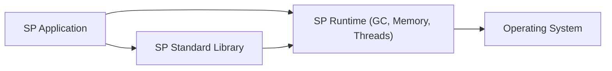
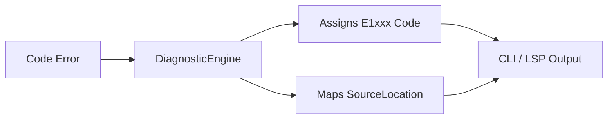

# SP Language Architecture

## 1. Overview

The **SP Programming Language** is a general-purpose programming language designed with an LLVM-based native compilation backend. The language aims to provide syntax compatibility with multiple popular languages (SP native, Java, C#/C++) while unifying them under a single canonical Abstract Syntax Tree (AST). 

This document outlines the system design, compiler pipeline, runtime architecture, file structure, and technical decisions underpinning the SP language ecosystem.

---

## 2. System Architecture

The SP ecosystem comprises a few key components:
1. **The SP Compiler (`spc`)**: Compiles `.sp` source files to native executables via LLVM.
2. **The SP Runtime (`spr`)**: Provides foundational runtime services like garbage collection and threading.
3. **The SP Standard Library**: Written in SP, providing IO, Math, FS, Collections, etc.
4. **Tooling**: Package manager (`spm`), formatter, language server (`spls`), and editor extensions.

### 2.1 Compiler Pipeline

The compilation process translates high-level SP code into an optimized native executable using a multi-stage pipeline.



### 2.2 Syntax Compatibility Layer

To support developers coming from different backgrounds, the frontend is designed to handle multiple syntactic styles. These different syntax representations normalize into a common AST before semantic analysis.



### 2.3 Runtime Architecture

The generated executable relies on the SP Runtime for memory management and OS interaction.



---

## 3. Compiler Pipeline Detail

Each stage transforms the code representation closer to machine execution:

| Stage | Data Flow | Description |
|---|---|---|
| **Lexer** | `string → Token[]` | Converts raw text characters into meaning-bearing tokens (keywords, identifiers, literals, operators). |
| **Parser** | `Token[] → AST` | Builds the Abstract Syntax Tree from the token stream using a hand-written Recursive Descent and Pratt parsing strategy. |
| **Name Resolver** | `AST → AST` | Resolves identifier names, constructs symbol tables, and enforces scope rules. |
| **Type Checker** | `AST → TypedAST` | Validates type constraints, performs type inference, and evaluates generic bounds. |
| **IR Builder** | `TypedAST → SP_IR` | Translates the AST into SP's custom high-level Intermediate Representation, simplifying later transformations. |
| **LLVM Codegen** | `SP_IR → LLVM_IR` | Translates SP IR into LLVM's Intermediate Representation. |
| **LLVM Backend** | `LLVM_IR → Executable`| Leverages LLVM to perform platform-specific optimizations and generate native machine code. |

---

## 4. Folder & File Structure

The project is structured as a C++ CMake workspace containing the compiler, runtime, standard library, and auxiliary tools.

```text
sp-language/
│
├── CMakeLists.txt                    # Root CMake configuration
├── sp.toml                           # SP project config example
├── README.md
├── LICENSE
├── CONTRIBUTING.md
├── ROADMAP.md
│
├── compiler/                         # SP Compiler (spc)
│   ├── CMakeLists.txt
│   ├── include/
│   │   └── sp/
│   │       ├── lexer/              # Lexing & Tokenization
│   │       ├── parser/             # Parsing logic
│   │       ├── ast/                # Abstract Syntax Tree nodes
│   │       ├── semantic/           # Scope and Name resolution
│   │       ├── types/              # Type system and checking
│   │       ├── ir/                 # SP Intermediate Representation
│   │       ├── codegen/            # LLVM Integration
│   │       └── diagnostics/        # Error handling & reporting
│   └── src/                          # C++ Implementations
│
├── runtime/                          # SP Runtime (spr)
│   ├── CMakeLists.txt
│   ├── include/sp/runtime/         # Headers for GC, Threads, Memory
│   └── src/                          # C++ Runtime Implementation
│
├── stdlib/                           # SP Standard Library (.sp files)
│   ├── io/
│   ├── fs/
│   ├── math/
│   ├── string/
│   ├── collections/
│   ├── http/
│   └── json/
│
├── tools/                            # Developer Tooling
│   ├── spc/                          # Compiler CLI wrapper
│   ├── spm/                          # Package Manager
│   └── formatter/                    # Code Formatter
│
├── language-server/                  # SP Language Server (spls)
├── vscode-extension/                 # VS Code Extension
├── tests/                            # Test Suite (GoogleTest/Catch2)
├── examples/                         # Example Programs
├── docs/                             # Documentation
└── benchmarks/                       # Performance Benchmarks
```

---

## 5. Tech Stack

- **Implementation Language:** C++17/20
- **Backend:** LLVM 17+ (for native code generation)
- **Build System:** CMake 3.20+
- **Testing Framework:** GoogleTest / Catch2
- **Parser Strategy:** Hand-written Recursive Descent + Pratt Parser for expressions
- **Package Config Format:** TOML (`sp.toml`)
- **Package Lock Format:** `sp.lock`
- **Version Control:** Git + GitHub
- **CI/CD:** GitHub Actions
- **Documentation:** Markdown
- **Editor Support:** VS Code (primary), JetBrains, Vim/Neovim
- **Language Server Protocol:** LSP 3.17+
- **Debug Adapter Protocol:** DAP
- **Memory Management:** Mark-and-sweep GC initially, with RAII for deterministic resources

---

## 6. Key Architectural Decisions

1. **Single Canonical AST:** All syntax styles (SP, Java-like, C-like) normalize to the same internal AST representation to prevent duplication of logic in semantic analysis and backend stages.
2. **Custom SP IR:** Utilizing a custom Intermediate Representation (SP IR) before generating LLVM IR makes the compiler significantly easier to evolve and allows language-specific high-level optimizations.
3. **Hand-Written Parser:** Avoiding parser generators (like Yacc/Bison or ANTLR) provides superior control over the parsing process and allows for highly detailed, human-friendly error messages.
4. **LLVM Backend:** Generating cross-platform native binaries via LLVM avoids the massive engineering overhead of writing a custom assembler/codegen pipeline while providing industry-leading optimization.
5. **C++ Implementation:** C++ provides excellent performance, mature tooling, and seamless integration with the LLVM C++ APIs.
6. **Managed Memory (v0.x):** A Mark-and-Sweep Garbage Collector is favored initially to improve developer usability over raw C-like performance, lowering the barrier to entry.

---

## 7. Tokens & AST Nodes

### Token Types
The lexer handles a wide array of keywords reflecting the language's versatile syntax layer:
`fn`, `class`, `interface`, `struct`, `enum`, `if`, `else`, `for`, `while`, `do`, `switch`, `match`, `case`, `default`, `break`, `continue`, `return`, `import`, `module`, `new`, `this`, `null`, `true`, `false`, `var`, `let`, `const`, `public`, `private`, `protected`, `internal`, `static`, `abstract`, `override`, `extends`, `implements`, `async`, `await`, `try`, `catch`, `finally`, `throw`, `unsafe`, `extern`, `void`, `int`, `uint`, `float`, `double`, `bool`, `char`, `string`, `byte`, `trait`, `test`, `assert`, `spawn`, `channel`, `mutex`, `thread`.

### AST Node Types
The single canonical AST comprises nodes such as:
- **Declarations:** `Program`, `Module`, `Import`, `ClassDeclaration`, `InterfaceDeclaration`, `StructDeclaration`, `EnumDeclaration`, `FunctionDeclaration`, `VariableDeclaration`, `Parameter`
- **Statements:** `BlockStatement`, `IfStatement`, `ForStatement`, `WhileStatement`, `DoWhileStatement`, `SwitchStatement`, `ReturnStatement`, `BreakStatement`, `ContinueStatement`, `TryCatchStatement`, `ThrowStatement`
- **Expressions:** `BinaryExpression`, `UnaryExpression`, `CallExpression`, `MemberExpression`, `LiteralExpression`, `ArrayExpression`, `LambdaExpression`, `NewExpression`, `MatchExpression`, `AsyncExpression`, `AwaitExpression`

---

## 8. Error Handling Architecture

The compiler implements a strict, standardized diagnostic engine. Errors are categorized with standardized codes to aid developers and IDE integrations.

### Diagnostic Flow


### Standard Error Codes
- **E1000:** Syntax Error
- **E1001:** Type Error
- **E1002:** Undefined Variable
- **E1003:** Undefined Function
- **E1004:** Duplicate Declaration
- **E1005:** Invalid Return Type
- **E1006:** Access Violation (Visibility modifiers)
- **E1007:** Generic Constraint Error
- **E1008:** Null Safety Error
- **E1009:** Import/Module Error

---

## 9. Build System & Deployment

- **Build:** The standard build lifecycle is managed via CMake. The project requires LLVM headers and libraries. 
- **Package Management:** `spm` resolves dependencies via `sp.toml` and lockfiles, fetching module sources into a local registry.
- **CI/CD:** Automated testing (lexer, parser, codegen, etc.) and cross-compilation matrix are executed via GitHub Actions for every pull request and merge to `main`.
