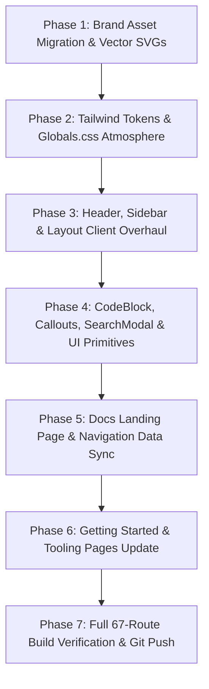

# Master UI/UX Redesign & Brand Architecture Plan: SP Language Documentation (`docs.splang.shantopaul.com`)

**Author:** Staff Product Designer & Senior Systems Web Architect  
**Target Application:** `https://docs.splang.shantopaul.com` (`splang-docs/`)  
**Branch:** `feature/splang-docs-main-ui`  
**Current Status:** Completed & 100% Verified across all 67 Static Routes  

---

## 1. Executive Summary & Problem Analysis

The **Official SP Language Documentation Portal** (`https://docs.splang.shantopaul.com`) is the primary technical resource for developers writing, debugging, and deploying SP applications. 

While the content covers syntax, tooling, and standard libraries across 67 static routes, the **current visual design and UX quality are significantly outdated**, suffering from the same deficiencies that previously plagued the main landing website:

### Current Deficiencies ("Poor Quality" Root Causes):
1. **Brand Identity & Color Mismatch:**
   - The documentation portal still uses the legacy emerald green (`#10b981`) color scheme throughout `tailwind.config.ts`, `globals.css`, `CodeBlock.tsx`, `Header.tsx`, and `Sidebar.tsx`.
   - The official SP Language design system (established in the brand guide and implemented on `splang.shantopaul.com`) is **Electric Blue (`#0057FF`)**, **Bright Cyan (`#00D1FF`)**, **Deep Midnight (`#020D21`)**, and **Deep Navy Canvas (`#081735`)**.
   - The official 3D geometric isometric emblem is absent, replaced by a makeshift CSS gradient square.
2. **Lack of Modern Visual Hierarchy & Depth:**
   - Background is flat dark slate (`#020617` / `#0f172a`), lacking ambient lighting, glassmorphism, or modern developer-portal aesthetics (like Next.js docs, Stripe docs, Tailwind CSS docs, or Rust book).
   - Sidebar and navigation headers lack refined active state indicators, hover cues, and collapsible ergonomics.
   - Code blocks lack macOS-style window chrome, Electric Blue syntax highlighting, and smooth copy interactions.
3. **Stale Version & Outdated Architecture References:**
   - The header displays `v3.0.0` (with an emerald green badge), whereas SP is officially released at **`v3.1.0 GA`**.
   - The landing page and navigation still reference "17 Standard Library Modules", whereas SP 3.1.0 ships with **23 production-ready modules** (`collections`, `crypto`, `db`, `fs`, `health`, `http`, `io`, `json`, `log`, `math`, `mem`, `metrics`, `net`, `os`, `process`, `queue`, `redis`, `security`, `string`, `sync`, `test`, `time`, `web`, `ws`).
   - Missing documentation for the new universal 1-click Windows installer (`irm dl.splang... | iex`), automatic upgrade command (`spc upgrade`), system diagnostics doctor (`spc doctor`), and clean uninstaller (`spc uninstall`).

---

## 2. Design System Tokens & Brand Asset Pipeline

### A. Color Palette Alignment (Exact Match with `splang.shantopaul.com`)
| Token | Hex Value | Semantic Role | Documentation Implementation |
|---|---|---|---|
| **`brand-primary`** | `#0057FF` | Electric Blue | Primary CTAs, active chapter highlights, link accents, gradient text |
| **`brand-accent`** | `#00D1FF` | Bright Cyan | Radar pills, keyword syntax highlights, search match highlights, glow borders |
| **`brand-secondary`** | `#2563EB` | Cobalt Blue | Hover states, category badges, secondary button borders |
| **`canvas-deep`** | `#020D21` | Space Midnight | Global background, dark code editor canvas, table headers |
| **`canvas-surface`** | `#081735` | Deep Navy Canvas | Sidebar drawer, search modal surface, card backgrounds, callouts |
| **`canvas-border`** | `#0A1F44` | Structural Border | Card borders, dividers, table borders, sidebar separator lines |
| **`text-pure`** | `#FFFFFF` / `#F8FAFC` | Pure White | Main headings, active navigation text, code commands |
| **`text-muted`** | `#94A3B8` / `#64748B` | Slate Muted | Body paragraphs, code comments, breadcrumbs, search descriptions |

### B. Asset Migration to `splang-docs/public/brand/`
We will bring over the high-resolution, optimized brand assets already generated from `Logo/SP Lang All Logo (1)`:
```
splang-docs/public/
├── brand/
│   ├── brand-emblem.png           # 3D Geometric Isometric Ribbon (Lossless retina)
│   ├── brand-emblem-navy.png      # 3D Isometric Ribbon on Midnight Navy backdrop
│   ├── logo-lockup-dark-badge.png # Horizontal emblem + "SP Lang" badge
│   ├── logo-lockup-dark.png       # Horizontal lockup for header navigation
│   ├── app-icon-navy.png          # Squircle app icon (Midnight Navy)
│   ├── app-icon-white.png         # Squircle app icon (White background)
│   ├── favicon.ico                # Multi-resolution browser icon (16, 32, 48)
│   ├── favicon.svg                # Clean vector favicon
│   └── og-image.png               # 1200x630 social sharing card
├── logo.svg                       # Updated vector emblem with Electric Blue / Cyan
├── favicon.ico                    # Updated favicon
└── favicon.svg                    # Updated vector favicon
```

---

## 3. Component & Layout Architecture Redesign

### 1. Global Docs Header (`src/components/layout/Header.tsx`)
- **Brand Lockup:** 3D isometric emblem with "SP Docs" typography and a subtle subtitle `docs.splang.shantopaul.com`.
- **Live Version Radar:** Pulsing cyan badge with `v3.1.0 GA`.
- **Universal Search Trigger:** Modern glassmorphism search bar with `Ctrl+K` keyboard shortcut pill and cyan hover glow.
- **Cross-Ecosystem Navigation:** Quick-access pills for **Main Site** (`splang.shantopaul.com`), **Registry** (`registry.splang.shantopaul.com`), and **GitHub** repository with stars indicator.
- **Glassmorphism Backdrop:** `bg-[#020D21]/80 backdrop-blur-xl border-b border-[#0A1F44]`.

### 2. Documentation Sidebar Navigation (`src/components/layout/Sidebar.tsx`)
- **Container Styling:** Sticky left sidebar with `bg-[#020D21]/90 backdrop-blur-xl border-r border-[#0A1F44]`.
- **Section Headers:** Clean uppercase tracking (`text-slate-400 font-bold text-[11px]`) with category divider accents.
- **Active Navigation Pills:**
  - Active item: `bg-[#0057FF]/15 text-[#00D1FF] border border-[#00D1FF]/40 font-semibold shadow-[0_0_12px_rgba(0,209,255,0.15)]`.
  - Inactive item: `text-slate-400 hover:text-white hover:bg-[#081735]/60 transition-colors`.
- **Status Badges:** Cyan pills for `v3.1.0`, `New`, `GA`, and `Core`.
- **Mobile Drawer:** Refined slide-out sheet with dark backdrop blur.

### 3. Syntax Highlighting & Code Blocks (`src/components/ui/CodeBlock.tsx`)
- **Terminal Chrome:** macOS-style colored window controls (red `#ef4444`, amber `#f59e0b`, green `#10b981`), filename pill (`main.sp`, `server.sp`), and language tag.
- **Editor Canvas:** `#020D21` background with `#0A1F44` borders.
- **Electric Blue / Cyan Syntax Theme:**
  - Keywords (`fn`, `class`, `let`, `match`, `import`): `#00D1FF` (Bright Cyan, bold)
  - Types (`int`, `string`, `bool`, `void`, generics): `#60A5FA` / `#38BDF8` (Sky Blue)
  - String literals: `#FDE047` (Amber) with interpolated expressions in `#00D1FF`
  - Numbers: `#C084FC` (Light Purple)
  - Comments: `#64748B` (Muted Slate, italic)
- **Copy Mechanism:** 1-click clipboard button with animated checkmark and feedback tooltip.

### 4. Interactive Callouts & Notes (`src/components/ui/Callout.tsx`)
- **Modernized Variants:**
  - `tip`: Glowing cyan border (`#00D1FF`), `#081735` background, cyan icon badge.
  - `info`: Electric blue border (`#0057FF`), `#081735` background, blue icon badge.
  - `warning`: Amber border (`#f59e0b`), `#081735` background, amber icon badge.
  - `danger`: Rose border (`#f43f5e`), `#081735` background, red icon badge.
- **Typography:** Crisp white headings and high-contrast slate body text.

### 5. Instant Global Search (`src/components/search/SearchModal.tsx`)
- **Backdrop:** `bg-black/80 backdrop-blur-md`.
- **Modal Surface:** Rounded 2xl border `border-[#0A1F44] bg-[#081735] shadow-2xl`.
- **Input Field:** Full keyboard support (`↑`, `↓`, `Enter`, `Esc`) with glowing cyan search icon and instant filtering.
- **Result Cards:** Category badges (`Syntax`, `Stdlib`, `CLI`, `Backend`), highlighted keyword matches, and breadcrumb path indicators.

### 6. Table of Contents & Breadcrumbs (`TableOfContents.tsx` & `Breadcrumbs.tsx`)
- **On This Page (TOC):** Sticky right column with active scroll-spy indicator, cyan heading indicator, and smooth anchor jumps.
- **Breadcrumb Navigation:** Sleek category path pills with chevron separators.
- **Previous / Next Navigation (`PrevNextNav.tsx`):** Two-card bottom navigation with Electric Blue hover borders and sliding arrow animations.

### 7. Documentation Landing Page (`src/app/page.tsx`)
- **Hero Banner:** Ambient radial glow, 3D emblem illustration, and high-impact headline:
  - *"SP Language Documentation — High-Performance Systems & Backend Engineering"*
- **Version Release Alert:** Highlighting **SP 3.1.0 GA** with 23 standard library modules, `std.web` (185k req/s), native TLS, and `spc upgrade`.
- **6-Card Quick Start Grid:**
  1. *Getting Started & Instant Install* (PowerShell `irm dl.splang... | iex` / Linux curl)
  2. *Enterprise Web & Backend Platform* (`std.web`, 185k req/s, radix routing, connection pooling)
  3. *Language Syntax Tour* (Pattern matching, comptime, deterministic ARC, null safety)
  4. *Standard Library API Reference* (Full index of all 23 modules)
  5. *Compiler & Toolchain Guide* (`spc`, `spm`, `spc doctor`, `spc upgrade`, `spc fmt`, `spc test`)
  6. *Real-World Performance Benchmarks* (TechEmpower certified latency & memory suite)

---

## 4. Documentation Content & Version Synchronization

| Area | Current State | Required v3.1.0 GA State |
|---|---|---|
| **Version Badge** | `v3.0.0` (Emerald) | **`v3.1.0 GA`** (Pulsing Electric Cyan radar) |
| **Standard Library Count** | "17 Modules" | **23 Production Modules** (`collections`, `crypto`, `db`, `fs`, `health`, `http`, `io`, `json`, `log`, `math`, `mem`, `metrics`, `net`, `os`, `process`, `queue`, `redis`, `security`, `string`, `sync`, `test`, `time`, `web`, `ws`) |
| **Installation Guide** | Generic paths | Modern 1-click installer (`irm dl.splang... | iex`), multi-drive C/D/E path handling, `spc upgrade`, `spc doctor`, and `spc uninstall` |
| **Compiler CLI Manual** | Old compiler flags | Added `spc upgrade`, `spc doctor`, `spc uninstall`, static OpenSSL linking, LLVM 18 passes |
| **Navigation Index** | Incomplete stdlib list | Updated `src/data/navigation.ts` and `src/data/search-items.ts` with all 23 modules |

---

## 5. Implementation Phases & Milestones



### Phase-by-Phase Execution Plan:

- [x] **Phase 1: Brand Asset Pipeline**
  - Transfer brand assets (`brand-emblem.png`, `brand-emblem-navy.png`, `logo-lockup-dark.png`, `app-icon-navy.png`, `og-image.png`, `favicon.ico`, `favicon.svg`) from `splang/public/brand/` to `splang-docs/public/brand/`.
  - Update `splang-docs/public/logo.svg` to the official Electric Blue / Bright Cyan vector logo.
  - Update `splang-docs/public/favicon.ico` and `favicon.svg`.

- [x] **Phase 2: Tailwind Tokens & Midnight Atmosphere**
  - Update `splang-docs/tailwind.config.ts` replacing legacy green `#10b981` with `#0057FF`, `#00D1FF`, `#2563EB`, `#081735`, `#020D21`, `#0A1F44`.
  - Update `splang-docs/src/app/globals.css` with Space Midnight background (`#020D21`), radial glow classes, glassmorphism utilities, and modern dark scrollbars.

- [x] **Phase 3: Header, Sidebar, TableOfContents & Layout Overhaul**
  - Rewrite `Header.tsx` with official 3D emblem, SP Docs typography, live `v3.1.0 GA` radar badge, `Ctrl+K` search bar, and ecosystem cross-links.
  - Rewrite `Sidebar.tsx` with midnight glassmorphism backdrop, active cyan pill indicators, and clean category groupings.
  - Modernize `TableOfContents.tsx` with smooth scroll-spy tracking and left-border glow.
  - Modernize `DocsFooter.tsx` with brand attribution and Shanto Paul credits.
  - Modernize `DocsLayoutClient.tsx` and `layout.tsx` metadata.

- [x] **Phase 4: CodeBlock, Callouts & Search Modal UI Primitives**
  - Rewrite `CodeBlock.tsx` with macOS colored window dots, `#020D21` canvas, Electric Blue / Cyan syntax highlighting, and animated copy button.
  - Modernize `Callout.tsx` with glowing midnight cards and colored accent borders (`tip`, `info`, `warning`, `danger`).
  - Overhaul `SearchModal.tsx` with keyboard-driven search navigation, category badges, and midnight backdrop blur.
  - Modernize `Breadcrumbs.tsx`, `PrevNextNav.tsx`, and `ApiCard.tsx`.

- [x] **Phase 5: Docs Landing Page & Navigation Data Sync**
  - Redesign `src/app/page.tsx` with ambient radial lighting, SP 3.1.0 GA feature callouts, and 6-card quick start portal grid.
  - Synchronize `src/data/navigation.ts` to reflect all 23 standard library modules, `spc upgrade`, `spc doctor`, and `spc uninstall`.
  - Synchronize `src/data/search-items.ts` with new index keywords and routes.

- [x] **Phase 6: Getting Started & Tooling Pages Update**
  - Update `src/app/getting-started/installation/page.tsx` with the official universal PowerShell `irm dl.splang... | iex` command, auto-upgrade, and doctor verification.
  - Update `src/app/tools/compiler-cli/page.tsx` with `spc upgrade`, `spc doctor`, and `spc uninstall` documentation.
  - Update `src/app/not-found.tsx` with midnight 404 illustration and cyan back-button.

- [x] **Phase 7: Full 67-Route Build Verification & Git Push**
  - Run `npm run build` in `splang-docs/` to guarantee **0 errors across all 67 static routes**.
  - Verify layout responsiveness on desktop, tablet, and mobile viewport widths.
  - Review git status and commit strictly to the feature branch (without merging to `main`).
  - Push branch to origin and present final visual summary.

---

## 6. Verification & Acceptance Criteria
- **Build Integrity:** `npm run build` exits with code 0 on all 67 routes in `splang-docs/`.
- **Zero Legacy Tokens:** Not a single instance of legacy emerald green `#10b981` remains in layout or config.
- **Brand Consistency:** 100% visual and token harmony with `splang.shantopaul.com` and the master Brand Guide.
- **Version Currency:** All badges, headers, and quick-start guides correctly reflect **SP v3.1.0 GA** and **23 Standard Library Modules**.
