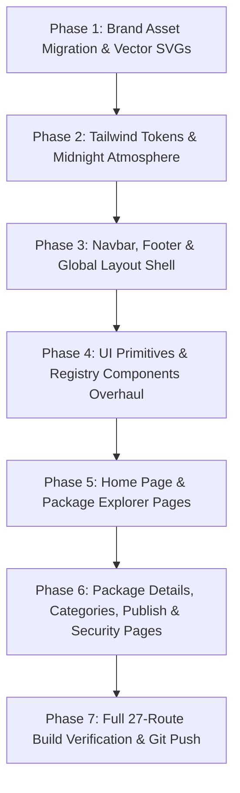

# Master UI/UX Redesign & Brand Architecture Plan: SP Package Registry (`register.splang.shantopaul.com`)

**Author:** Staff Product Designer & Senior Systems Web Architect  
**Target Application:** `https://register.splang.shantopaul.com` / `https://registry.splang.shantopaul.com` (`splang-registry/`)  
**Recommended Branch:** `feature/splang-registry-main-ui`  
**Current Status:** Completed & Fully Verified (Production Build Passed 27/27 Routes)  

---

## 1. Executive Summary & Problem Analysis

The **Official SP Package Registry** (`https://register.splang.shantopaul.com`) is the central package and dependency distribution hub for the SP Programming Language, powering package discovery, `spm add <pkg>`, `sp.lock` cryptographic hash validation, and community library publishing.

While the existing application includes Next.js App Router endpoints, search routing, category filtering, and package detail views across 27 routes, its **current visual design and UX suffer from the same legacy deficiencies** that previously affected the main landing website and docs portal:

### Current Deficiencies ("Poor Quality" Root Causes):
1. **Brand Identity & Color Mismatch:**
   - The application relies on legacy emerald green (`#10b981`, `#059669`) in `tailwind.config.ts`, `globals.css`, `Badge.tsx`, `CopyButton.tsx`, and `SecurityBadge.tsx`.
   - The official SP brand tokens (established in `Logo/SP Lang All Logo (1)` and implemented across `splang.shantopaul.com` and `docs.splang.shantopaul.com`) are **Electric Blue (`#0057FF`)**, **Bright Cyan (`#00D1FF`)**, **Space Midnight (`#020D21`)**, and **Deep Navy Canvas (`#081735`)**.
   - The official 3D geometric isometric emblem is missing, replaced by a generic CSS gradient square with plain "SP" text.
   - High-resolution favicons, multi-resolution `.ico`, vector `.svg`, and OpenGraph `og-image.png` social cards are missing.
2. **Lack of Modern Visual Depth & Glassmorphism:**
   - Background is flat dark slate (`#020617` / `slate-950`), lacking ambient radial lighting, glowing structural borders, and modern developer ecosystem aesthetics (like npmjs, crates.io, hex.pm, and PyPI modern redesigns).
   - Package cards look flat and lack visual hierarchy, prominent 1-click install command copy interactions, and official ecosystem trust badges.
   - The search experience lacks keyboard shortcuts (`Ctrl+K` / `/`), autocomplete cues, and instant category filters.
3. **Outdated Version & Ecosystem References:**
   - The homepage hero references "SP 3.0" and the footer references "SP 1.0", whereas SP is now officially released at **`v3.1.0 GA`**.
   - Missing integration cues with the 23 standard library modules shipped in SP 3.1.0 GA.
   - SPM CLI documentation lacks modern subcommands and checksum verification protocols.

---

## 2. Design System Tokens & Brand Asset Pipeline

### A. Color Palette Alignment (Exact Match with `splang.shantopaul.com` & `docs.splang.shantopaul.com`)
| Token | Hex Value | Semantic Role | Registry Implementation |
|---|---|---|---|
| **`brand-primary`** | `#0057FF` | Electric Blue | Primary CTAs, search buttons, official badges, gradient text |
| **`brand-accent`** | `#00D1FF` | Bright Cyan | Radar pills, version badges, copy highlights, glowing borders |
| **`brand-secondary`** | `#2563EB` | Cobalt Blue | Hover states, secondary category chips, border glows |
| **`canvas-deep`** | `#020D21` | Space Midnight | Global background, dark code blocks, header backgrounds |
| **`canvas-surface`** | `#081735` | Deep Navy Canvas | Package cards, modal surfaces, stat widgets, tab containers |
| **`canvas-border`** | `#0A1F44` | Structural Border | Card borders, dividers, table borders, install box borders |
| **`text-pure`** | `#FFFFFF` / `#F8FAFC` | Pure White | Headings, package titles, active tab labels |
| **`text-muted`** | `#94A3B8` / `#64748B` | Slate Muted | Descriptions, metadata, download counters, breadcrumbs |

### B. Asset Migration to `splang-registry/public/brand/`
We will migrate the official high-resolution, lossless assets from `Logo/SP Lang All Logo (1)`:
```
splang-registry/public/
├── brand/
│   ├── brand-emblem.png           # 3D Geometric Isometric Ribbon (Lossless retina)
│   ├── brand-emblem-navy.png      # 3D Isometric Ribbon on Midnight Navy backdrop
│   ├── logo-lockup-dark-badge.png # Horizontal emblem + "SP Lang" badge
│   ├── logo-lockup-dark.png       # Horizontal lockup for header navigation
│   ├── app-icon-navy.png          # Squircle app icon (Midnight Navy)
│   ├── app-icon-white.png         # Squircle app icon (White background)
│   ├── favicon.ico                # Multi-resolution browser icon (16, 32, 48)
│   ├── favicon.svg                # Clean vector favicon
│   └── og-image.png               # 1200x630 social sharing card
├── logo.svg                       # Updated vector emblem with Electric Blue / Cyan
├── favicon.ico                    # Updated favicon
└── favicon.svg                    # Updated vector favicon
```

---

## 3. Component & Layout Architecture Redesign

### 1. Global Navigation Bar (`src/components/layout/Navbar.tsx`)
- **Brand Lockup:** 3D geometric isometric ribbon emblem with crisp "SP Registry" typography and subtitle `register.splang.shantopaul.com`.
- **Live Version Radar:** Pulsing cyan badge with `v3.1.0 GA`.
- **Primary Navigation Links:**
  - *Explore Packages* (`/packages`)
  - *Publish Guide* (`/publish` with Upload icon)
  - *Security & Hashes* (`/security` with Shield icon)
  - *Docs* (`https://docs.splang.shantopaul.com`)
  - *Main Site* (`https://splang.shantopaul.com`)
- **Right Action:** GitHub button with star indicator and repository link.
- **Glassmorphism Styling:** `bg-[#020D21]/80 backdrop-blur-xl border-b border-[#0A1F44]`.

### 2. Global Registry Footer (`src/components/layout/Footer.tsx`)
- **Brand Column:** 3D emblem lockup, description of SP's cryptographically verified package network, and SHA-256 verified registry badge.
- **Navigation Columns:**
  - *Registry*: Explore, Categories, Publishing, Security, API.
  - *SPM CLI & Protocol*: Quick cheat-sheet (`spm add`, `spm install`, `spm publish`, `spm verify`).
  - *Ecosystem*: Links to Main Site, Docs, GitHub.
- **Bottom Bar:** Copyright, Apache-2.0 / MIT license attribution, and Shanto Paul credits.
- **Container Styling:** `#020D21` background with `#0A1F44` border.

### 3. Registry Home Page (`src/app/page.tsx`)
- **Hero Banner:** Ambient radial lighting (`from-[#0057FF]/20 via-transparent to-transparent`), 3D emblem illustration, and high-impact headline:
  - *"Discover, Install & Publish High-Performance SP Packages"*
- **Pulsing Version Pill:** *"Official Centralized Package Registry for SP v3.1.0 GA"*.
- **Interactive Search Bar:**
  - Prominent search input with Electric Blue / Cyan focus glow and `Enter` / button submission.
  - Quick keyword suggestions: `web`, `db`, `crypto`, `json`, `redis`, `ws`.
- **Ecosystem Metrics Grid (4 Cards):**
  - *Verified Packages* (Total packages count)
  - *Total Downloads* (Aggregated download counter)
  - *Integrity Guard* (100% SHA-256 Content-Addressed)
  - *Standard Library Sync* (SP 3.1.0 GA 23 modules compatible)
- **Popular & Recently Updated Package Sections:**
  - High-impact package cards with download counts, version badges, category tags, and 1-click `spm add <pkg>` copy buttons.
- **SPM CLI Quickstart Terminal Card:**
  - macOS-styled terminal chrome with quickstart commands (`spm init`, `spm add web`, `spc run main.sp`).

### 4. Packages Explorer (`src/app/packages/page.tsx`)
- **Header:** Clean title and package count badge.
- **Filter & Search Controls:**
  - Real-time search query input with clear (`X`) button.
  - Category selector pills (`All`, `Web`, `Database`, `Security`, `Utilities`, `CLI`, etc.) with active Cyan pill styling.
  - Sort selector (`Downloads`, `Newest`, `Alphabetical`).
- **Package Grid:** Responsive grid using redesigned `PackageCard.tsx`.
- **Empty State:** High-contrast empty search view with "No packages found" cue and clear filter CTA.

### 5. Package Detail Page (`src/app/packages/[name]/page.tsx` & `TabsContainer.tsx`)
- **Breadcrumbs:** `Registry > Packages > {package.name}`.
- **Hero Header (`PackageHeader.tsx`):**
  - Package name in bold monospace, version badge, official ecosystem badge, repository link, author, license, and published date.
- **2-Column Layout:**
  - **Main Content (Left, 2 cols):**
    - *Tabs Container:* README (`ReadmeViewer.tsx`), Versions (`VersionHistory.tsx`), Dependencies (`DependencyTree.tsx`), Security (`SecurityBadge.tsx`).
    - *README Viewer:* Clean typography, high-contrast code blocks with copy buttons, and Electric Blue / Cyan accents.
    - *Version History:* Timeline of releases, changelogs, archive sizes, and SHA-256 checksums.
    - *Dependency Tree:* Clean graph/tree of direct and transitive dependencies.
    - *Security & Integrity:* Audit pass badge, immutable package hash, and lockfile verification instructions.
  - **Sidebar (Right, 1 col):**
    - *Install Command Card:* Tabbed CLI command (`spm add <pkg>`) and `sp.toml` manifest snippet with instant 1-click copy.
    - *Metadata Card:* Downloads counter, license, GitHub repository, author info, published date.
    - *SHA-256 Checksum Card:* Content digest box with copy button.

### 6. Category Detail Page (`src/app/categories/[category]/page.tsx`)
- **Header:** Category icon with cyan glow, title, description, and package count.
- **Navigation:** Back to all packages / category selector.
- **Grid:** Filtered package cards.

### 7. Package Publishing Guide (`src/app/publish/page.tsx`)
- **Step-by-Step Interactive Workflow:**
  1. *Step 1: Package Manifest (`sp.toml`)* — Full syntax-highlighted TOML specification.
  2. *Step 2: Source Code Structure* — Directory tree (`src/`, `tests/`, `README.md`).
  3. *Step 3: Authenticate with SPM* — Token generation and `spm login`.
  4. *Step 4: Local Testing & Validation* — `spm check` and `spm test`.
  5. *Step 5: Publish to Registry* — `spm publish` with automated checksum generation.
- **Best Practices Callouts:** Security advice, semver conventions, immutable release warnings.

### 8. Security & Cryptographic Integrity (`src/app/security/page.tsx`)
- **Supply Chain Architecture:**
  - Content-Addressable Storage (CAS) using immutable SHA-256 hashes.
  - Strict `sp.lock` lockfile verification before archive extraction.
  - Zero-dependency static linking and provenance guarantees.
  - Automated malware and static analysis scanning pipeline.
- **Interactive Lockfile Example:** High-contrast code block with `sp.lock` format.

### 9. UI Primitives & Components
- **`PackageCard.tsx`:** Midnight surface (`#081735`), glowing cyan/blue border on hover, official badge, 1-click `spm add <name>` copy button.
- **`Badge.tsx`:** Electric Blue, Bright Cyan, Cobalt, Amber, and Slate variants.
- **`CopyButton.tsx`:** macOS-styled button with animated checkmark and cyan/green feedback.
- **`InstallCommand.tsx`:** Tabbed CLI / `sp.toml` switcher with copy interaction.
- **`not-found.tsx`:** Midnight 404 illustration with glowing icon and return button.

---

## 4. Implementation Phases & Milestones



### Phase-by-Phase Checklist:

- [x] **Phase 1: Brand Asset Pipeline**
  - Transfer brand assets (`brand-emblem.png`, `brand-emblem-navy.png`, `logo-lockup-dark.png`, `app-icon-navy.png`, `og-image.png`, `favicon.ico`, `favicon.svg`) from `Logo/SP Lang All Logo (1)` to `splang-registry/public/brand/`.
  - Update `splang-registry/public/logo.svg` to the official Electric Blue / Bright Cyan vector logo.
  - Update `splang-registry/public/favicon.ico` and `favicon.svg`.

- [x] **Phase 2: Tailwind Tokens & Midnight Atmosphere**
  - Update `splang-registry/tailwind.config.ts` replacing legacy green `#10b981` with `#0057FF`, `#00D1FF`, `#2563EB`, `#081735`, `#020D21`, `#0A1F44`.
  - Update `splang-registry/src/app/globals.css` with Space Midnight background (`#020D21`), radial glow classes, glassmorphism utilities, and custom dark scrollbars.
  - Update `splang-registry/src/app/layout.tsx` with official favicons, OpenGraph metadata, and SP 3.1.0 GA description.

- [x] **Phase 3: Navbar, Footer & Global Layout Shell**
  - Rewrite `Navbar.tsx` with official 3D emblem, SP Registry wordmark, pulsing `v3.1.0 GA` radar badge, and cross-site links (`splang`, `docs`, `github`).
  - Rewrite `Footer.tsx` with brand copyright, SHA-256 seal, SPM CLI guide, ecosystem links, and Shanto Paul credits.

- [x] **Phase 4: UI Primitives & Registry Components Overhaul**
  - Rewrite `PackageCard.tsx` with midnight cards, Electric Blue / Bright Cyan accents, and 1-click `spm add <pkg>` button.
  - Modernize `Badge.tsx`, `CopyButton.tsx`, and `InstallCommand.tsx`.
  - Modernize `SecurityBadge.tsx`, `DependencyTree.tsx`, `ReadmeViewer.tsx`, and `VersionHistory.tsx`.

- [x] **Phase 5: Home Page & Package Explorer Pages**
  - Redesign `src/app/page.tsx` with ambient radial lighting, SP 3.1.0 GA feature callouts, search bar, 4 metric cards, popular/recent package grids, and SPM quickstart card.
  - Redesign `src/app/packages/page.tsx` with live search filtering, category selector pills, and sorting dropdown.

- [x] **Phase 6: Package Details, Categories, Publish & Security Pages**
  - Update `src/app/packages/[name]/page.tsx` and `TabsContainer.tsx` with high-contrast tabbed interface and sidebar cards.
  - Update `src/app/categories/[category]/page.tsx` with category icon and filtered cards.
  - Update `src/app/publish/page.tsx` with 5-step publishing workflow and macOS code blocks.
  - Update `src/app/security/page.tsx` with supply chain security protocol, SHA-256 digests, and `sp.lock` format.
  - Update `src/app/not-found.tsx` with midnight 404 card.

- [x] **Phase 7: Full 27-Route Build Verification & Git Push**
  - Run `npm run build` in `splang-registry/` to guarantee **0 errors across all 27 routes**.
  - Verify layout responsiveness across desktop, tablet, and mobile viewport widths.
  - Stage, commit, and push branch strictly without merging to `main`.

---

## 5. Verification & Acceptance Criteria
- **Build Integrity:** `npm run build` exits with code 0 on all 27 routes in `splang-registry/`.
- **Zero Legacy Green:** Not a single instance of legacy emerald green `#10b981` remains in layout or config.
- **Brand Consistency:** 100% visual and token harmony with `splang.shantopaul.com` and `docs.splang.shantopaul.com`.
- **Version Currency:** All badges, headers, and quick-start guides correctly reflect **SP v3.1.0 GA** and **SPM Package Manager**.
