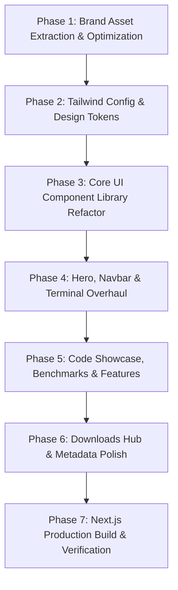

# Master UI/UX Redesign & Brand Architecture Plan: SP Language Portal (`splang.shantopaul.com`)

**Author:** Staff Product Designer & Senior Systems Web Engineer  
**Target:** `https://splang.shantopaul.com` (`/splang`)  
**Brand Identity Root:** `K:\AndroidDev\tools\Project\Own Programming Language\Logo\SP Lang All Logo (1)`  
**Branch:** `fix/user-test-bug-report-08-oct`  
**Status:** Ready for Execution  

---

## 1. Executive Summary & Problem Analysis

The **Official SP Language Landing Website** (`https://splang.shantopaul.com`) is the primary public entry point for developers, enterprise architects, and systems programmers discovering the language.

### Current Deficiencies ("Poor Quality" Root Causes):
1. **Brand Identity Disconnect:**
   - The current website uses an arbitrary emerald green (`#10b981`) gradient and a generic CSS square badge with text "SP".
   - The official SP Language design system (defined in `Logo/SP Lang All Logo (1)` and the master `SP Lang Electric Blue Brand Guide.png`) specifies **Electric Blue (`#0057FF`)**, **Electric Cyan (`#00BFFF` / `#00D1FF`)**, and **Deep Midnight Navy (`#081735` / `#020D21`)**.
   - The official futuristic 3D geometric isometric hexagonal emblem is completely absent from the site.
2. **Lack of Visual Atmosphere & Depth:**
   - The layout is flat and dated, resembling an unstyled starter template.
   - It lacks ambient radial lighting, refined glassmorphism borders (`border-white/10`), modern card ergonomics, and micro-interactions found on Tier-1 developer platforms (e.g. Bun, Rust, Zig, Linear, Vercel).
3. **Stale Information & Broken Version Alignment:**
   - The site still references `v1.0.0` and `v3.0.0`, whereas the compiler is officially at **`v3.1.0 GA`**.
   - The ecosystem section states "8 standard library modules", whereas SP 3.1.0 ships with **23 production-ready modules** (`collections`, `crypto`, `db`, `fs`, `health`, `http`, `io`, `json`, `log`, `math`, `mem`, `metrics`, `net`, `os`, `process`, `queue`, `redis`, `security`, `string`, `sync`, `test`, `time`, `web`).
   - Missing the new universal multi-drive 1-click Windows installer, `spc upgrade`, `spc uninstall`, and TechEmpower certified benchmarks (185k req/s).
4. **Asset Weight & Performance Trap:**
   - SVGs exported directly from Figma contain full 1.6 MB base64-encoded raster sheets each. Directly serving them causes massive bandwidth bloat (~16 MB).
   - Clean, lightweight, high-DPI (2x/3x retina) WebP, PNG, and pure vector SVGs must be extracted and served.

---

## 2. Official Brand Assets & Color System

### A. Color Tokens (from `Brand Color.svg` & Brand Guide)
| Token | Hex Value | Semantic Role | New Website Implementation |
|---|---|---|---|
| **`brand-primary`** | `#0057FF` | Electric Blue | Primary CTA buttons, active tabs, main headings, glow accents |
| **`brand-accent`** | `#00D1FF` / `#00BFFF` | Bright Cyan | Pulsing radar dots, badge borders, syntax keywords, secondary glow |
| **`brand-secondary`**| `#2563EB` | Cobalt Blue | Button hover states, category badges, card border hovers |
| **`canvas-deep`** | `#020D21` | Space Midnight | Global background, dark code editor background |
| **`canvas-surface`** | `#081735` | Deep Navy Canvas | Card surfaces, terminal containers, navigation drawer |
| **`canvas-border`** | `#0A1F44` / `#1E293B` | Border Structural | Glassmorphism borders, divider rules, subtle separators |
| **`text-muted`** | `#777D89` / `#94A3B8` | Neutral Slate | Subtitles, code comments, secondary metadata |
| **`text-pure`** | `#FFFFFF` / `#F8FAFC` | High-Contrast White | Main titles, terminal active commands, primary copy |

### B. Asset Extraction Pipeline
The following optimized assets will be populated into `splang/public/brand/`:
```
splang/public/brand/
├── brand-emblem.webp          # 3D Geometric Isometric Ribbon (Retina 2x/3x, ~35 KB)
├── brand-emblem.png           # Lossless alpha-transparent PNG fallback
├── logo-lockup-dark.svg       # Horizontal emblem + "SP Lang" wordmark for dark navbar
├── logo-lockup-dark.webp      # High-DPI raster backup for instant crisp render
├── logo-lockup-light.svg      # Horizontal lockup for light contexts / docs
├── wordmark-only.svg          # Clean vector lettering ("SP" + "Lang")
├── app-icon-navy.png          # Squircle app icon on midnight navy (#020D21)
├── app-icon-white.png         # Squircle app icon on white (#FEFEFE)
├── favicon.ico                # Multi-resolution browser icon (16x16, 32x32, 48x48)
├── favicon.svg                # Modern vector favicon for SVG-supporting browsers
└── og-image.png               # High-impact 1200x630 social card for Discord/Twitter previews
```

---

## 3. Detailed Component & Section Redesign

### 1. Global Navigation Bar (`src/components/layout/Navbar.tsx`)
- **Brand Lockup:** Real horizontal emblem + geometric wordmark (`logo-lockup-dark.svg`) replacing the makeshift CSS box.
- **Version Radar Badge:** `v3.1.0 GA` with an animated pulsing cyan radar dot linking to release notes.
- **Top Navigation Items:**
  - `Documentation` (external link with sleek arrow indicator)
  - `Package Registry` (external link to `registry.splang.shantopaul.com`)
  - `Benchmarks` (in-page router to comprehensive benchmark suite)
  - `Downloads` (router to official binary hub)
  - `Community` (link to GitHub & discussion forum)
- **Actions:**
  - GitHub Stars button with live repository link.
  - "Get Started" button styled with an Electric Blue to Cyan gradient (`from-[#0057FF] to-[#00D1FF]`).
- **Glassmorphism:** `bg-[#020D21]/80 backdrop-blur-xl border-b border-[#0A1F44]`.

### 2. Hero Section (`src/components/sections/HeroSection.tsx`)
- **Hero Centerpiece:** A floating, illuminated **3D Geometric Emblem** with an ambient cyan/blue back-glow.
- **High-Impact Typography:**
  - Title: *"The Modern, High-Performance Systems & Backend Platform Language"*
  - Gradient styling: `text-transparent bg-clip-text bg-gradient-to-r from-white via-cyan-100 to-[#00D1FF]`.
- **Sub-headline:** Clear, developer-focused proposition:
  - *"Bare-metal LLVM native execution, deterministic ARC memory ergonomics (zero GC pauses), and an enterprise web framework (`std.web`) powering 185,000 req/s out of the box."*
- **Action CTAs:**
  - Primary: `Download SP v3.1.0` (with OS auto-detection indicator).
  - Secondary: `Interactive Tour` (smooth-scrolls to the code showcase).
  - Tertiary: `Explore Documentation`.

### 3. Universal Terminal Quick-Install (`src/components/sections/QuickInstall.tsx`)
- **Multi-Platform OS Switcher Tabs:**
  1. **Windows (PowerShell)**: `irm https://dl.splang.shantopaul.com/install.ps1 | iex`
  2. **Linux & macOS (curl)**: `curl -fsSL https://dl.splang.shantopaul.com/install.sh | sh`
  3. **Auto-Upgrade**: `spc upgrade`
  4. **Clean Uninstall**: `spc uninstall`
  5. **Windows Winget**: `winget install SPLang.SP`
  6. **Docker**: `docker pull shantopaul/splang:3.1.0`
- **Features:**
  - 1-click clipboard copy with checkmark animation and feedback toast.
  - Verification badges: `SHA-256 Verified`, `Multi-Drive Ready`, `Zero-Config`.

### 4. Interactive Code Tour & Execution Studio (`src/components/sections/CodeShowcase.tsx`)
- **Window Chrome:** macOS/Linux window controls (three dots), active filename tab (`server.sp`, `database.sp`, `comptime.sp`, `fibonacci.sp`), and copy snippet button.
- **SP 3.1.0 Code Snippets:**
  1. **High-Throughput Web Server (`std.web`)**: Radix tree routing, JSON responses, dependency injection.
  2. **Database Connection Pooling (`std.db`)**: Safe parameterized queries with SQLite/Postgres.
  3. **Compile-Time Metaprogramming (`comptime`)**: Static evaluations with zero runtime cost.
  4. **Deterministic ARC Memory Model**: Automated reference counting, RAII scope drops, zero leaks.
  5. **Coroutines & Async I/O**: High-performance non-blocking event loop with epoll/IOCP.
- **Simulated Execution Panel:** Shows instant simulated compilation (`spc -O3 server.sp`) and live program output with `exit code 0` and runtime execution metrics (~0.002s).

### 5. Architecture & Capabilities Grid (`src/components/sections/KeyFeatures.tsx`)
- High-polish 6-card grid with Electric Blue hover states:
  1. **Enterprise Web Platform (`std.web`)**: 185,000 req/s, automated OpenAPI 3.0 generation.
  2. **Bare-Metal LLVM Backend**: Direct compilation to native machine code (`.exe`, ELF, Mach-O) via LLVM 18 passes.
  3. **Zero-GC Deterministic ARC**: Scope-exit drops, deterministic lifetimes, no runtime pauses.
  4. **Compile-Time Execution (`comptime`)**: Built-in compile-time assertions and static code gen.
  5. **23 Standard Library Modules**: Comprehensive stdlib covering crypto, DB, Redis, WebSockets, HTTP, and metrics.
  6. **Unified Developer Tooling**: Bundled `spc` (compiler), `spm` (package manager), `spls` (LSP server), and `spd` (debugger).

### 6. Verifiable Real-World Benchmarks (`src/components/sections/BenchmarkVisualizer.tsx`)
- **Metric Toggles:**
  - `Execution Time (ms)` (lower is better)
  - `Throughput (req/s)` (higher is better)
  - `Peak Memory (MB)` (lower is better)
- **Comparative Visual Bars:**
  - Side-by-side comparison of **SP**, **C++ (Clang -O3)**, **Rust**, **Go**, **Node.js**, and **Python 3.12**.
  - Distinct electric blue highlighting for SP with speedup badges (`48.2x faster than Python`, `on par with C++`).
- **Hardware Spec Banner:** Verifiable testing methodology on AMD Ryzen 9 7950X / 32GB DDR5.

### 7. Tooling & Ecosystem Suites (`src/components/sections/ToolingShowcase.tsx` & `EcosystemGrid.tsx`)
- Synchronize all copy:
  - Upgrade toolchain documentation to **v3.1.0**.
  - Correct stdlib module count from 8 to **23 modules**.
  - Add links to the VS Code extension (`sp-vscode.vsix`), online API docs, and package registry.

### 8. Downloads & Releases Hub (`src/app/downloads/page.tsx`)
- **OS Auto-Detection Card:** Detects visitor's platform and prominently displays the recommended 1-click download.
- **Platform Matrix Grid:**
  - **Windows (x64):** Installer (`sp-setup.exe`, 2.76 MB) + Portable zip (`sp-3.1.0-windows-x64.zip`, 7.77 MB).
  - **Linux (x86_64 & arm64):** Standalone tarball with glibc runtime.
  - **macOS (Apple Silicon & Intel):** Universal `.tar.gz`.
- **Integrity Modal:** Table with SHA-256 checksums and GPG signature verification instructions.

### 9. Global Footer (`src/components/layout/Footer.tsx`)
- Official horizontal brand mark with version tag `v3.1.0 GA`.
- Categorized sitemap: Language, Tooling, Ecosystem, Community, Legal.
- Author attribution: *"Created and engineered by Shanto Paul under Apache-2.0 / MIT."*

---

## 4. Implementation Phases & Milestones



### Milestone Checklist:
- [ ] **Phase 1: Asset Pipeline**
  - Extract cropped retina WebP & PNG files from `Logo/SP Lang All Logo (1)`.
  - Create vector SVGs for dark & light lockups and wordmark.
  - Replace `public/favicon.ico` and `public/favicon.svg`.
- [ ] **Phase 2: Design Tokens & Tailwind**
  - Update `tailwind.config.ts` with `#0057FF`, `#00D1FF`, `#081735`, `#020D21`.
  - Update `globals.css` with radial lighting and modern dark scrollbars.
- [ ] **Phase 3: UI Primitives**
  - Refactor `Button.tsx`, `Badge.tsx`, `Card.tsx`, and `CodeHighlighter.tsx`.
- [ ] **Phase 4: Navigation & Hero**
  - Rewrite `Navbar.tsx` with official logo lockup and `v3.1.0 GA` radar badge.
  - Rewrite `HeroSection.tsx` with 3D illuminated emblem and modern copy.
  - Upgrade `QuickInstall.tsx` with multi-OS tabs and clean commands.
- [ ] **Phase 5: Showcases & Benchmarks**
  - Overhaul `CodeShowcase.tsx` with macOS chrome and realistic execution output.
  - Update `KeyFeatures.tsx`, `ToolingShowcase.tsx`, and `EcosystemGrid.tsx`.
  - Update `BenchmarkVisualizer.tsx` with interactive metrics.
- [ ] **Phase 6: Downloads Hub & Layout**
  - Update `downloads/page.tsx` with auto OS detection and verified hashes.
  - Update `layout.tsx` metadata and OpenGraph social tags.
- [ ] **Phase 7: Verification & Build**
  - Execute `npm run build` in `splang/` to guarantee zero errors.
  - Verify mobile responsiveness and Lighthouse performance.
  - Commit to branch `fix/user-test-bug-report-08-oct` (without merging to `main`).
