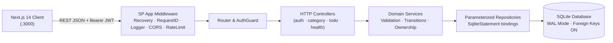

# ToDoList Architecture Guide

## System Overview

The **ToDoList** example demonstrates a production-grade fullstack web application with clean separation between:

- **Backend (`examples/ToDoList/backend/`)**: Written 100% in **SP Programming Language v4.0.0**, compiled via LLVM directly to a native executable (`todolist-backend.exe`), persisted with embedded **SQLite WAL**, secured with **Argon2id** password hashing and **HMAC-SHA256 JWT** tokens.
- **Frontend (`examples/ToDoList/frontend/`)**: Built with **Next.js 14 (App Router)**, strict **TypeScript**, **Tailwind CSS**, and **Lucide React** icons, featuring optimistic updates, debounced search, bulk operations, keyboard shortcuts (`n`, `/`, `Escape`), and dark/light theme support.

---

## Backend Layered Architecture (Pure SP Language)

| Layer | Directory | Responsibility |
| :--- | :--- | :--- |
| **Entrypoint** | `src/main.sp` | Loads `.env`, fails closed if `JWT_SECRET < 32` chars, initializes SQLite schema, binds HTTP server |
| **Config** | `src/config/env.sp` | Parses `.env` without overriding OS environment variables; validates port, DB path, JWT TTL, CORS origins |
| **Routing** | `src/routes/router.sp` | Registers middleware pipeline, static-before-parameterized routes, OpenAPI JSON, Swagger UI (`/docs`), ReDoc (`/redoc`) |
| **Middleware** | `src/middleware/auth.sp` | Extracts `Authorization: Bearer <token>`, verifies JWT signature/expiry via `AuthService`, resolves active `User` |
| **Controllers** | `src/controllers/*.sp` | Parses JSON bodies/query/path params, enforces auth checks, cleans native handles, formats JSON / RFC 7807 Problem Details |
| **Services** | `src/services/*.sp` | Enforces domain rules, validates fields, enforces multi-tenant ownership (`403` vs `404`), manages `completed_at` transitions |
| **Repositories** | `src/repositories/*.sp` | Executes SQLite parameterized prepared queries (`?` bindings only) with explicit statement finalization and connection closing |
| **Database** | `src/db/schema.sp` | Opens WAL-mode SQLite connections (`PRAGMA foreign_keys = ON`), executes idempotent migrations and index setup |
| **Models** | `src/models/*.sp` | Strongly typed entities (`User`, `Category`, `Todo`, `TodoStats`, `PaginatedTodos`) with safe JSON serializers |
| **Utilities** | `src/util/*.sp` | JSON escaping & null-aware getters (`json.sp`), domain validators (`validation.sp`), RFC 7807 responses (`error.sp`), JSON logging (`logger.sp`) |

---

## Security & Reliability Guardrails

1. **Fail-Closed Startup (`src/main.sp`)**:
   - No hardcoded fallback JWT signing keys exist anywhere in source code.
   - Server refuses to boot (`exit code 1`) unless `JWT_SECRET` is at least 32 characters.
2. **Password Hashing (`std.crypto.password`)**:
   - Passwords are hashed using **Argon2id** (`Password.hash`) and verified in constant time (`Password.verify`).
   - `password_hash` is never serialized into `User.toPublicJson()` or logged.
3. **Strict Multi-Tenant Ownership**:
   - Every category and todo row belongs to a `user_id`.
   - Single-item reads, updates, deletes, and bulk mutations check ownership and return `403 Forbidden` (or affect `0` rows on bulk attempts) when a different user attempts access.
4. **Parameterized SQL Only**:
   - Dynamic search, status, priority, due-date, and pagination queries bind user values exclusively via `SqliteStatement.bindString` / `bindInt` / `bindNull`.
   - Sort columns and directions are mapped from strict allowlists — raw user strings never enter `ORDER BY`.
5. **Deterministic Resource Cleanup**:
   - All native SP handles (`SqliteConnection`, `SqliteStatement`, `JsonValue`, `JwtValidationResult`, `HttpResponse`) are explicitly finalized/closed/destroyed across both success and early-return error paths.

---

## Frontend Architecture (Next.js 14 App Router)

| Layer | Location | Purpose |
| :--- | :--- | :--- |
| **Types** | `src/types/*.ts` | Strict TypeScript contracts mirroring backend JSON & RFC 7807 `ProblemDetails` |
| **API Client** | `src/lib/api-client.ts` | Centralized `fetch` wrapper injecting `Bearer` tokens, parsing `ApiError`, and triggering `401` sign-out callbacks |
| **Providers** | `src/lib/auth-context.tsx`, `toast-context.tsx` | Session hydration (`GET /api/v1/auth/me`) and accessible toast notifications |
| **Hooks** | `src/hooks/useTodos.ts`, `useCategories.ts`, `useTheme.ts`, `useKeyboardShortcuts.ts` | Debounced search, optimistic completion/deletion with rollback, bulk selection, theme toggle, keyboard navigation |
| **Components** | `src/components/{ui,layout,auth,categories,todos}/` | Accessible UI primitives, sidebar/topbar shell, quick-add bar, filter toolbar, bulk action bar, slide-over edit drawer |
| **Routes** | `src/app/{page,login/page,register/page,settings/page}.tsx` | Workspace dashboard, auth flows, profile & backend health settings |
