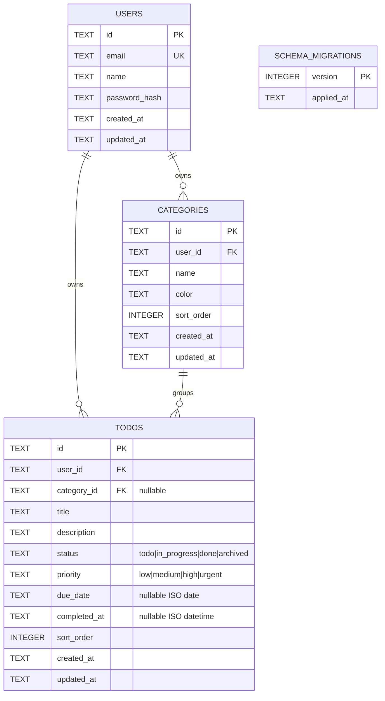

# ToDoList Database Schema (SQLite WAL)

## Configuration Pragmas

Every SQLite connection opened via `DatabaseManager.open()` (`src/db/schema.sp`) enables:

- **WAL Journal Mode** (`walMode = true`, busy timeout `5000ms`) for concurrent readers and crash safety
- **`PRAGMA foreign_keys = ON;`** enforced per connection so cascading deletes and `SET NULL` constraints execute reliably

---

## Entity-Relationship Diagram

---

## Table Definitions

### `users`
- `id`: UUID v4 primary key (`TEXT PRIMARY KEY`)
- `email`: Lowercased unique email (`TEXT NOT NULL UNIQUE`)
- `name`: Display name (`TEXT NOT NULL`)
- `password_hash`: Argon2id PHC hash (`TEXT NOT NULL`)
- `created_at`, `updated_at`: UTC ISO-8601 timestamps

### `categories`
- `FOREIGN KEY (user_id) REFERENCES users(id) ON DELETE CASCADE`
- `UNIQUE (user_id, name)` plus service-layer case-insensitive duplicate guard
- Index: `idx_categories_user_sort (user_id, sort_order, name)`

### `todos`
- `FOREIGN KEY (user_id) REFERENCES users(id) ON DELETE CASCADE`
- `FOREIGN KEY (category_id) REFERENCES categories(id) ON DELETE SET NULL` — deleting a category preserves existing tasks cleanly
- Indexes:
  - `idx_todos_user_status (user_id, status)`
  - `idx_todos_user_priority (user_id, priority)`
  - `idx_todos_user_due (user_id, due_date)`
  - `idx_todos_category (category_id)`

---

## Migrations Strategy

`DatabaseManager.initSchema()` creates tables and indexes idempotently using `CREATE TABLE IF NOT EXISTS` and records version `1` into `schema_migrations` via `INSERT OR IGNORE`.
